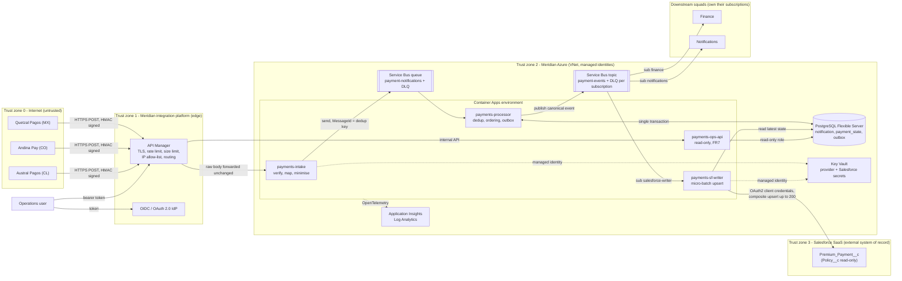

# Solution Design — Premium Payment Notifications

> Scope: FR1–FR7 and NFR1–NFR9 for Mexico (Quetzal Pagos), Colombia (Andina Pay) and Chile (Austral Pagos).
> Related decisions: [ADR-0001](../adr/0001-salesforce-integration.md), [ADR-0002](../adr/0002-stack-and-data-store.md), [ADR-0003](../adr/0003-error-classification-and-dead-lettering.md).
> Assumptions are numbered `A-n` and listed in [`docs/ASSUMPTIONS.md`](../ASSUMPTIONS.md).

## 1. Design in one paragraph

A thin **intake** service verifies each provider's signature, maps the notification to a **canonical payment event** through a provider-specific adapter, drops payer personal data, and enqueues it durably in Azure Service Bus **before** answering `2xx`. A **processor** enforces idempotency and ordering against a small PostgreSQL state store (inbox + payment state + outbox) and publishes accepted state changes to a Service Bus **topic**. Salesforce is just one subscriber of that topic: a **Salesforce writer** upserts payments in **micro-batches of up to 200 records**, always writing the *latest known state* of each payment, behind a circuit breaker and an API-budget guard. Finance and Notifications subscribe to the same topic. A read-only **ops API** exposes the processing status of any notification (FR7).

## 2. Context diagram and trust boundaries



| Boundary | What crosses it | Control |
|---|---|---|
| 0 → 1 | Provider webhooks | TLS 1.2+, API Manager rate limit and max body size (64 KB), provider IP allow-list where the provider publishes ranges (A-3). Providers cannot obtain an IdP token, so **authenticity is proven by the HMAC signature**, verified in zone 2 where the secrets live. |
| 1 → 2 | Webhooks, ops API calls | Container Apps ingress accepts traffic from the API Manager only (private connectivity or IP restriction, A-2). The ops API validates the IdP token and the `payments.ops.read` role again (defence in depth). |
| Inside 2 | Messages, state, secrets | Managed identities with data-plane RBAC only (Service Bus Data Sender/Receiver, Key Vault Secrets User, PostgreSQL Entra ID roles); local/SAS auth disabled. **No payer personal data exists beyond the intake adapter.** |
| 2 → 3 | Payment upserts | OAuth 2.0 client credentials, token cached for its lifetime, egress only to the Salesforce domain. |
| 2 → downstream | Canonical events | Each consumer gets its own subscription and its own identity with *Receiver* on that subscription only. |

## 3. Sequence of one notification, including failure paths

```mermaid
sequenceDiagram
  autonumber
  participant P as Provider
  participant M as API Manager
  participant I as payments-intake
  participant Q as SB queue
  participant R as payments-processor
  participant D as PostgreSQL
  participant T as SB topic
  participant W as payments-sf-writer
  participant S as Salesforce

  P->>M: POST /payments/webhooks/v1/{provider} (raw body + signature headers)
  M->>I: forward raw body, add X-Correlation-Id
  I->>I: verify HMAC (constant time) and timestamp tolerance
  alt invalid signature or stale timestamp
    I-->>P: 401 (no body logged, metric signature_failures{country})
  else unparseable payload with valid signature
    I-->>P: 400 (metric + alert, provider retries per its policy)
  else valid
    I->>I: adapter maps to canonical event, drops payer PII, normalises reference
    I->>Q: send (MessageId = dedup key, CorrelationId)
    alt Service Bus unavailable or send timeout (> 2 s)
      I-->>P: 503 (not accepted, provider retries)
    else enqueued
      I-->>P: 200 (accepted, NFR3 starts here)
    end
  end

  Q->>R: receive (peek-lock)
  R->>D: BEGIN; insert notification (UNIQUE dedup_key)
  alt duplicate dedup key
    R->>D: increment duplicate_count; COMMIT
    R->>Q: complete (status DUPLICATE)
  else new notification
    R->>D: SELECT payment_state FOR UPDATE
    alt event is older or lower precedence than current state
      R->>D: notification SUPERSEDED; COMMIT
      R->>Q: complete (nothing published)
    else state advances
      R->>D: upsert payment_state (version + 1), insert outbox row; COMMIT
      R->>T: publish canonical event (MessageId = eventId)
      R->>D: mark outbox published
      R->>Q: complete
    end
  end
  Note over R,D: DB unavailable: abandon with backoff, max delivery 10, then queue DLQ

  T->>W: receive batch (up to 200 msgs or 5 s)
  W->>D: read latest payment_state for the batch payment keys
  W->>S: PATCH composite upsert (allOrNone=false, up to 200 records)
  alt 2xx per record
    W->>D: sf_synced_version = version, notification RECORDED
    W->>T: complete
  else 400 data error for a record (e.g. INVALID_FIELD policy not found)
    W->>T: dead-letter that message now (reason SF_DATA_ERROR + code), no retry
    W->>D: notification FAILED
  else 400 UNABLE_TO_LOCK_ROW for a record
    W->>T: reschedule with exponential backoff (max 5), then dead-letter
  else 5xx, timeout or connection error
    W->>W: circuit breaker opens, stop receiving, half-open probe every 60 s
    Note over W,T: messages stay in the subscription, delivery count not burned
  else 403 REQUEST_LIMIT_EXCEEDED or budget guard at 80 %
    W->>W: stop all Salesforce calls for 15 min, page on-call
  else 401 INVALID_SESSION_ID
    W->>S: refresh token once, retry the batch once
  end
```

## 4. Canonical payment event

### 4.1 Envelope and fields

The event uses the **CloudEvents 1.0** envelope (an open, provider-neutral standard) so that the version, the type and the schema location travel with every message. The JSON Schema is in [`docs/api/events/premium-payment.schema.json`](../api/events/premium-payment.schema.json).

| Field | Type | Example | Notes |
|---|---|---|---|
| `specversion` | string | `1.0` | CloudEvents version. |
| `id` | string (UUID v5) | `5b0c…` | **Deterministic**: UUID v5 of the dedup key, so a replay produces the same `id` and consumers can deduplicate. |
| `source` | string | `/meridian/payments/andina-co` | Provider adapter that produced it. |
| `type` | string | `com.meridian.payments.premium-payment.status-changed.v1` | **Major version in the type**: a breaking change creates `.v2` and both are published during migration. |
| `dataschema` | URI | `…/premium-payment/1.2.0` | Exact schema version (semver). Minor versions only add optional fields. |
| `time` | string (UTC) | `2026-11-28T19:03:09Z` | Time of the state change at the provider (= `data.occurredAt`). |
| `correlationid` | string | `7f3a0c2e-…` | CloudEvents extension, end-to-end trace id (NFR7). |
| `data.paymentKey` | string | `ANDINA:TRX-CO-5521907` | `{PROVIDER}:{providerTransactionId}`. Becomes `Payment_Key__c`. |
| `data.provider` | enum | `ANDINA` | `QUETZAL`, `ANDINA`, `AUSTRAL` (extensible). |
| `data.country` | enum | `CO` | ISO 3166-1 alpha-2. |
| `data.providerTransactionId` | string | `TRX-CO-5521907` | Charge / transaction / payment id. |
| `data.providerEventId` | string | `ntf-8f1c2a77` | Event or notification id as sent by the provider. |
| `data.status` | enum | `CAPTURED` | `PENDING`, `CAPTURED`, `FAILED`, `REFUNDED`. |
| `data.providerStatus` | string | `APROBADA` | Original value, for traceability. |
| `data.amount` | object | `{ "value": "185000.00", "currency": "COP" }` | Decimal **string in major units**, scale from ISO 4217 minor units (MXN 2, COP 2, CLP 0). Never a float. |
| `data.refundedAmount` | object, optional | `{ "value": "1250.00", "currency": "MXN" }` | Only for `REFUNDED`. |
| `data.policyNumber` | string \| null | `POL-CO-000187342` | **Normalised** policy number; `null` when the reference cannot be resolved. |
| `data.rawReference` | string | `000215560` | Reference exactly as received, for diagnosis. |
| `data.referenceResolution` | enum | `EXACT` | `EXACT`, `NORMALISED`, `UNRESOLVED`. |
| `data.paymentMethod` | enum | `BANK_TRANSFER` | `CARD`, `BANK_TRANSFER`, `CASH`, `OTHER`. No tokens. |
| `data.reasonCode` | string, optional | `insufficient_funds` | `failure_code` or `motivo_reverso`. |
| `data.occurredAt` | string (UTC) | `2026-11-28T19:03:09Z` | Provider time of the state change. Drives ordering. |
| `data.receivedAt` | string (UTC) | `2026-11-28T19:03:11Z` | Time Meridian accepted the notification. Drives freshness SLIs. |
| `data.paymentVersion` | integer | `2` | Monotonic per `paymentKey`, set by the processor. Lets consumers discard stale events. |

**Payer personal data (names, national IDs, emails) is deliberately not part of the event** (data minimisation, NFR6). Consumers that need customer contact data resolve it in Salesforce from the policy (A-7).

### 4.2 Mapping per provider

| Canonical | Quetzal Pagos (MX) | Andina Pay (CO) | Austral Pagos (CL) |
|---|---|---|---|
| `providerTransactionId` | `data.charge.id` | `transaccion.id` | `payment.paymentId` |
| `providerEventId` | `id` | `notificacion_id` (changes per retry) | `eventId` |
| `amount.value` | `data.charge.amount` ÷ 10^minorUnits (`125000` → `1250.00`) | `transaccion.valor` as is (`185000.00`) | `payment.amount` as is (`45990`, CLP scale 0) |
| `amount.currency` | `data.charge.currency` **upper-cased** (`mxn` → `MXN`) | `transaccion.moneda` | `payment.currency` |
| `refundedAmount` | `data.charge.amount_refunded` ÷ 10^minorUnits | `transaccion.valor` (full reversal) | `payment.amount` (full reversal) |
| `policyNumber` | `data.charge.reference` → normalise | `transaccion.referencia` → **normalise** (see 4.3) | `payment.policyNumber` → normalise |
| `paymentMethod` | `payment_method.type`: `card` → `CARD`, other → `OTHER` | `medio_pago`: `TARJETA` → `CARD`, `PSE` → `BANK_TRANSFER`, `EFECTIVO` → `CASH` | not provided → `OTHER` |
| `occurredAt` | `succeeded`: `paid_at`; `refunded`: `refunded_at`; `failed`: `created` | `transaccion.fecha_transaccion` → UTC | `payment.occurredAt` |
| `reasonCode` | `failure_code` | `motivo_reverso` | — |
| Dropped (PII) | `customer.email`, `payment_method.token` | `pagador.*` | `payer.*` |

| Canonical status | Quetzal `type` | Andina `estado` | Austral `eventType` | `Premium_Payment__c.Status__c` |
|---|---|---|---|---|
| `PENDING` | — | `PENDIENTE` | — | `Pending` |
| `CAPTURED` | `charge.succeeded` | `APROBADA` | `PAYMENT_CONFIRMED` | `Captured` |
| `FAILED` | `charge.failed` | `RECHAZADA` | `PAYMENT_REJECTED` | `Failed` |
| `REFUNDED` | `charge.refunded` (total or partial, A-5) | `REVERSADA` | `PAYMENT_REVERSED` | `Refunded` |
| *(ignored, `200` + metric)* | any other `type` | unknown `estado` | unknown `eventType` | — |

Unknown event types are acknowledged and ignored rather than rejected, so that a provider adding new events does not cause retry storms; they are counted and visible in the ops API.

### 4.3 Policy reference normalisation

Payment references are customer-influenced input (Andina 2.3 delivers `referencia` "exactly as entered by the payer"), so every adapter normalises them before they reach Salesforce:

1. Trim, remove inner spaces, upper-case.
2. If it matches `^POL-(MX|CO|CL)-\d{9}$` and the country matches the provider → `EXACT` (or `NORMALISED` if step 1 changed it).
3. If it is only digits (1–9 of them) → left-pad to 9 and prefix `POL-{country}-` → `NORMALISED` (A-6).
4. Otherwise → `policyNumber = null`, `UNRESOLVED`. The notification is **still accepted** (the money moved; rejecting would only make the provider retry and eventually give up). It is parked for operations with reason `UNRESOLVED_REFERENCE` instead of being sent to Salesforce.

## 5. Idempotency and ordering (FR4, FR5)

### 5.1 Keys

| Provider | Dedup key (business event) | Payment key (`Payment_Key__c`) | Why |
|---|---|---|---|
| Quetzal | `QUETZAL:{id}` | `QUETZAL:{data.charge.id}` | Event `id` is stable across retries. |
| Andina | `ANDINA:{transaccion.id}:{transaccion.estado}` | `ANDINA:{transaccion.id}` | `notificacion_id` **changes on every retry**, so it cannot detect duplicates; the spec states that `id + estado` identifies the business event. `notificacion_id` is still stored as an attempt id for FR7. |
| Austral | `AUSTRAL:{eventId}` | `AUSTRAL:{paymentId}` | `eventId` stable across retries; no signed timestamp, so `eventId` is also the replay defence. |

### 5.2 Where it is enforced (defence in depth)

| Layer | Mechanism | Guarantees |
|---|---|---|
| 1. Inbound queue | Service Bus **duplicate detection**, `MessageId = dedup key`, window 7 days (covers Quetzal 3 d, Austral 48 h, Andina 24 h). | Cheap filter for most of the ≈ 3 % duplicates. Best effort only. |
| 2. Processor | `UNIQUE(dedup_key)` on `notification`, inserted in the same transaction as the state change. | **Authoritative** exactly-once in business terms, also across replays. |
| 3. Processor | `SELECT … FOR UPDATE` on `payment_state` row. | Concurrent events for the same payment are serialised across replicas. |
| 4. Topic | `MessageId = eventId` (deterministic) + duplicate detection; consumers receive `paymentVersion`. | Outbox re-publication never produces a different event. |
| 5. Salesforce | Upsert by external ID `Payment_Key__c`. | Re-sending a record updates it, never duplicates it. |

### 5.3 Ordering rule

Each status has a **precedence rank**: `PENDING = 1`, `CAPTURED = 2`, `FAILED = 2`, `REFUNDED = 3`. An incoming event is applied when:

- `rank(new) > rank(current)`, **or**
- `rank(new) = rank(current)` **and** `occurredAt(new) > occurredAt(current)` (e.g. a second partial refund).

Otherwise it is recorded as `SUPERSEDED` and not published. Consequences:

- A late `APROBADA` arriving after `REVERSADA` never turns a refunded payment back into captured (the FR5 example).
- A `REFUNDED` that arrives first creates the payment directly as `Refunded`; the later `CAPTURED` is superseded. Salesforce never sees a transient `Captured`, so the reinstatement flow is not triggered wrongly.
- `CAPTURED` vs `FAILED` on the same transaction is not a valid provider lifecycle (A-4). If it happens, the later `occurredAt` wins and the anomaly is flagged for operations.

Ordering is resolved on **provider time and lifecycle**, not on arrival order, which is why Service Bus sessions are not used (they would only preserve arrival order, which providers do not guarantee anyway).

The Salesforce writer does not write the event it received; it writes the **current row of `payment_state`** for that payment key. Whatever the order in which messages reach Salesforce, the record converges to the latest known state, and replaying an old message is harmless.

## 6. Error handling, dead-lettering and replay

| Stage | Error | Class | Behaviour |
|---|---|---|---|
| Intake | Invalid signature, stale timestamp | Reject | `401`. No body logged. Metric per country; alert if rate > 1 % in 10 min (secret rotation or attack). |
| Intake | Malformed payload with a valid signature | Reject | `400`. Alert: it is a provider contract change. |
| Intake | Unknown event type / state | Ignore | `200`, metric, visible in the ops API. |
| Intake | Service Bus send fails or exceeds 2 s | Not accepted | `503`; the **provider's retry is our buffer**. Intake never answers `2xx` before the send is acknowledged (NFR3). |
| Processor | DB unavailable, deadlock | Transient | Abandon; redelivery with in-process backoff (1, 2, 4 s); max delivery count 10 → queue DLQ. |
| Processor | Canonical message invalid against schema | Poison | Dead-letter immediately, reason `SCHEMA_INVALID`. |
| Writer | `5xx`, timeout, connection reset | Transient, systemic | **Circuit breaker**: after 5 consecutive failures stop receiving; half-open probe every 60 s. Messages wait in the subscription (TTL 7 days) without burning delivery count. |
| Writer | `400 UNABLE_TO_LOCK_ROW` | Transient, per record | Re-schedule that message with backoff 30 s → 8 min (max 5), then dead-letter. |
| Writer | `400 INVALID_FIELD`, `FIELD_CUSTOM_VALIDATION_EXCEPTION`, `REQUIRED_FIELD_MISSING` | **Permanent, data** | **Dead-letter immediately**, reason `SF_DATA_ERROR:<code>`. No retry: retrying data errors only burns the shared API budget (the root cause of INC-0412's budget spike). Alert per country. |
| Writer | `403 REQUEST_LIMIT_EXCEEDED` | Systemic, shared | Stop **all** calls for 15 min, page on-call. Never retry eagerly: the limit is org-wide. |
| Writer | `401 INVALID_SESSION_ID` | Auth | Refresh token once, retry once; then circuit open + alert. |
| Writer | `policyNumber = null` | Permanent, data | Never sent to Salesforce; dead-lettered with reason `UNRESOLVED_REFERENCE`. |

**Replay** is safe by construction: messages are canonical events (no PII), the dedup key and `eventId` are deterministic, and the writer writes the current `payment_state`. The replay procedure (an ops CLI with `--dry-run`) is:

1. Fix the cause first (e.g. deploy a corrected adapter, or correct the data in `payment_state`).
2. Dry run: count DLQ messages by reason, country and age.
3. Re-submit in batches, rate-limited (default 20 batches/min) and subject to the same budget guard.
4. Watch `notification.processing_status` move to `RECORDED`; anything that fails again returns to the DLQ with its new reason.

For `UNRESOLVED_REFERENCE`, operations corrects `policy_number` through the ops API (audited) before replay.

## 7. Capacity (NFR1, NFR2, NFR5)

### 7.1 Load

| Figure | Normal day | Month-end peak day | Burst |
|---|---|---|---|
| Notifications | 15,000 / day (0.17 /s) | 120,000 / day (1.4 /s) | 40 /s for 15 min = 36,000 |
| Per country (MX 45 / CO 40 / CL 15 %) | 6,750 / 6,000 / 2,250 | 54,000 / 48,000 / 18,000 | 18 / 16 / 6 per s |
| After dedup (−3 %) | 14,550 | 116,400 | 38.8 /s |
| Per month | ≈ 26 × 15 k + 4 × 120 k ≈ **870,000** notifications | | |

### 7.2 Salesforce: why per-record synchronous writes do not fit

| Approach | Calls on peak day | Concurrency needed at 40 /s | Fits? |
|---|---|---|---|
| One upsert per notification | ≈ 116,000 (**78 % of the 150 k budget**, before retries) | 40 /s × 1.2 s (p95) ≈ **48** > 25 allowed | **No** |
| Micro-batch up to 200 records, flush every 5 s | Bounded by flush rate: ≤ 17,280 per writer replica per day, **≈ 600** at peak (116,400 ÷ 200) | 1 call / 5 s, ≈ 4 s each → **≤ 2** | **Yes** |

The writer runs **max 2 replicas**, so the theoretical worst case (every flush with a single record) is 2 × 17,280 = 34,560 calls/day = **23 % of the budget**; the realistic peak is well under 1 %. This leaves the shared org limit untouched and the 25-concurrency agreement far away. A **budget guard** reads the `Sforce-Limit-Info` response header, keeps a rolling 24 h counter, and halts at 80 % of 150,000.

### 7.3 Intake and messaging

- Andina's 5 s timeout is the tightest. Intake does only CPU work (HMAC, mapping) plus one Service Bus send (p99 ≈ 50 ms), so p99 < 500 ms. Container Apps scale on concurrent HTTP requests (min 2 replicas for availability, max 10).
- Service Bus Standard throughput is far above 40 msg/s. Operations per notification ≈ 10 (send, receive, complete, publish, 3 subscriptions × receive/complete) → ≈ 8.7 M ops/month, inside the 13 M included in the Standard base charge.
- The processor does ≈ 3 SQL statements per notification: 40 /s → 120 statements/s, trivial for a 2-vCore PostgreSQL.

### 7.4 Freshness (NFR2)

Happy path: intake < 1 s + processor < 1 s + batch wait ≤ 5 s + composite upsert p95 4 s ≈ **11 s at p95**, so the 5-minute target has a wide margin.

Salesforce is the limiting factor. At 97 % availability (≈ 22 h of outage per month in windows of 5–90 min):

- **95 % within 5 min**: notifications that arrive while Salesforce is down are delayed until recovery. If outages are spread over time, ≈ 3 % of notifications fall in them → ≈ 97 % within 5 min. **Met**, with a small margin.
- **99.5 % within 1 h**: only outages longer than 60 min produce delays above 1 h. If, say, 4 outages of 90 min happen in a month, the first 30 min of each (2 h in total, ≈ 0.3 % of the month) exceed 1 h → **met**. If most of the 22 h came as 90-minute windows (≈ 15 of them), ≈ 1 % of notifications would exceed 1 h → **not met**. **The integration cannot guarantee this SLO alone**; the SLO is reported with Salesforce unavailability as a separate dimension (see `OPERATIONS.md`) and this risk is raised with the Salesforce team.
- **Recovery drain**: after a 90-minute outage on a peak day the backlog is ≈ 7,500 notifications ≈ 38 calls, drained in < 2 minutes. Recovery does not create a second spike.

## 8. Data persisted outside Salesforce

Salesforce remains the **system of record**. The integration keeps only the state it needs for idempotency, ordering, outbox delivery and operations (FR4, FR5, FR7). **No payer personal data is stored** (NFR6): retention is therefore driven by operations and audit needs, not by personal data protection law.

Store: **Azure Database for PostgreSQL Flexible Server** (see [ADR-0002](../adr/0002-stack-and-data-store.md)).

```sql
CREATE TABLE notification (                    -- inbox + processing log (FR4, FR7)
  id                      uuid PRIMARY KEY,
  dedup_key               text NOT NULL UNIQUE,  -- e.g. ANDINA:TRX-CO-5521907:APROBADA
  provider                text NOT NULL,
  country                 char(2) NOT NULL,
  provider_event_id       text NOT NULL,          -- first attempt id
  attempt_ids             text[] NOT NULL,        -- every attempt id seen (Andina retries)
  duplicate_count         int NOT NULL DEFAULT 0,
  provider_transaction_id text NOT NULL,
  payment_key             text NOT NULL,
  canonical_status        text NOT NULL,
  occurred_at             timestamptz NOT NULL,
  received_at             timestamptz NOT NULL,
  correlation_id          uuid NOT NULL,
  processing_status       text NOT NULL,          -- RECEIVED, APPLIED, SUPERSEDED, RECORDED, FAILED, DEAD_LETTERED
  last_error_code         text,
  last_error_detail       text,                   -- sanitised, no payloads
  raw_body_sha256         char(64) NOT NULL,      -- proves what was received without keeping PII
  updated_at              timestamptz NOT NULL
);
CREATE INDEX ix_notification_tx      ON notification (provider, provider_transaction_id);
CREATE INDEX ix_notification_payment ON notification (payment_key);
CREATE INDEX ix_notification_attempt ON notification USING gin (attempt_ids);
CREATE INDEX ix_notification_corr    ON notification (correlation_id);
CREATE INDEX ix_notification_problem ON notification (country, received_at)
  WHERE processing_status IN ('FAILED', 'DEAD_LETTERED');

CREATE TABLE payment_state (                    -- latest known state per payment (FR5)
  payment_key             text PRIMARY KEY,       -- = Payment_Key__c
  provider                text NOT NULL,
  country                 char(2) NOT NULL,
  provider_transaction_id text NOT NULL,
  policy_number           text,
  amount                  numeric(18,2) NOT NULL,
  currency                char(3) NOT NULL,
  status                  text NOT NULL,
  status_rank             smallint NOT NULL,
  status_changed_at       timestamptz NOT NULL,
  last_event_id           text NOT NULL,
  version                 bigint NOT NULL,
  sf_synced_version       bigint NOT NULL DEFAULT 0,
  sf_synced_at            timestamptz,
  updated_at              timestamptz NOT NULL
);
CREATE INDEX ix_payment_unsynced ON payment_state (updated_at) WHERE sf_synced_version < version;

CREATE TABLE outbox (                           -- reliable publication to the topic
  event_id      uuid PRIMARY KEY,
  payment_key   text NOT NULL,
  payload       jsonb NOT NULL,
  created_at    timestamptz NOT NULL,
  published_at  timestamptz
);
CREATE INDEX ix_outbox_pending ON outbox (created_at) WHERE published_at IS NULL;
```

| Aspect | Decision |
|---|---|
| Volume | ≈ 10.5 M notifications/year, ≈ 1 KB per row with indexes → ≈ 12 GB/year. No partitioning needed at this size; monthly range partitioning on `received_at` is the next step if volume grows 10×. |
| Retention | `notification`: 13 months (a full year of month-end cycles for audits and chargeback disputes, A-8). `payment_state`: 25 months after the last change. `outbox`: 7 days after publication. Purged by a daily job. |
| Reconciliation | `ix_payment_unsynced` feeds an hourly job: any payment with `sf_synced_version < version` for more than 1 h is re-enqueued and counted as a **loss risk** per country (NFR7). |
| Backup | Built-in PITR, 7 days (dev/test), 35 days (prod). |

## 9. Operations access (FR7)

- **`payments-ops-api`**, a read-only HTTP API published as an **internal** API in the API Manager:
  - `GET /payments/ops/v1/notifications?provider=ANDINA&id={any provider id}` → searches `provider_transaction_id`, `attempt_ids` and `dedup_key`.
  - `GET /payments/ops/v1/notifications/{correlationId}` and `GET /payments/ops/v1/payments/{paymentKey}` → status timeline, error codes, Salesforce sync state, DLQ reason.
  - `POST /payments/ops/v1/payments/{paymentKey}/policy-number` → correction for `UNRESOLVED_REFERENCE` (role `payments.ops.write`, audited).
- **Security**: IdP-issued token required (validated by the API Manager and again by the service), roles `payments.ops.read` / `payments.ops.write` assigned to operations and on-call groups only. The API connects with a read-only PostgreSQL role (write endpoint uses a separate role scoped to `payment_state.policy_number`). Every call is logged with the caller's identity. Responses contain no personal data because none is stored.
- **Aggregates** (freshness, DLQ depth, failures per country) live in an Azure Monitor workbook; individual lookups use the ops API, so nobody needs to search raw logs.

## 10. Extensibility (NFR9)

Adding a fourth provider (say Peru) requires:

1. A new `ProviderAdapter` implementation (signature verification, mapping, dedup key, reference format) and its test vectors.
2. Configuration: a route in the API Manager, a secret in Key Vault, an entry in the adapter registry.
3. A new `Provider__c` picklist value in Salesforce (owned by the Salesforce team).

The queue, processor, ordering rules, store, topic, writer and ops API do not change.

## 11. Security and privacy summary (NFR6)

- Provider secrets and the Salesforce client secret live in **Key Vault**, read through managed identity and cached in memory with refresh. Two secret versions can be active at once to support rotation (Quetzal sends two `v1` signatures; for Andina and Austral the adapter tries current then previous).
- Signatures are verified on the **raw bytes** with a constant-time comparison; timestamp tolerance is 300 s (Quetzal) and 600 s (Andina).
- Payer personal data is discarded inside the intake adapter, never enqueued, persisted or logged. Logs contain identifiers only (provider ids, payment key, correlation id); request bodies are never logged at any level.
- Least-privilege RBAC per component: intake can only **send** to the inbound queue; processor can only **receive** from it and **send** to the topic; writer can only **receive** from its subscription.
